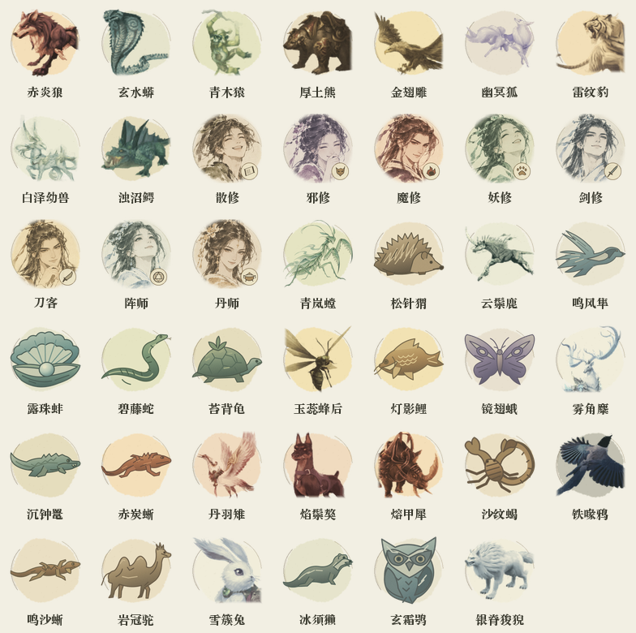

# 妖兽林地与怪物图鉴

六郡各有六片妖兽林，每片林地包含外围、深处及兽王巢，共 108 个战斗子图。城市、坊市、洞府等地图沿用所在郡的地利。玩家查材料时先定位郡，再按怪物、战区、档位缩小范围。[地域与物产](region-ecology.md)

## 从地图找到怪物

| 数据表 | 输入与输出 |
| --- | --- |
| 林地战区 | 游戏地图键 → 数字战区 ID、郡 ID、遭遇层次 ID、群落 ID。与原项目 `game_map.go`、`MapTree.java` 的存量妖兽林键逐个对应 |
| 遭遇层次 | 以普通、精英、兽王位的顺序，外围默认 5／1／0，深处 4／1／1，兽王巢 1／2／2。策划填入完整工程 `monsters.json` 的默认波次 |
| 战区群落、群落怪物 | 每个战区引用一个本郡群落。同一群落可以在多片林地出现，三档分别登记候选怪物与局部权重 |
| 地区怪物、怪物图鉴 | 郡与怪物决定基础丰度。怪物 ID 指向名称、属性对象、兽王资格，旧对象类型和图标仍能对照 |
| 怪物产出、资源用途 | 同一物种同一材料的本郡掉率覆盖通用掉率。概率按击败单只的档位取值，随后按模板查材料的工艺用途 |

现有 36 个群落每组有四种普通、三种精英和两种可为兽王的候选。层次先决定本档波位数，为零时该档相遇概率为零。有波位时，候选票数为郡内权重乘以阴阳五行及主气修正，再乘群落局部权重。同档票数归一为选中概率。一个群落出现在多图时，修改一次即可同时生效。

例如临仙郡 `1111W11` 的外围是松风竹海，普通位可遇青岚螳，掉落岚纹镰刃可用来炼器或制作刻符工具。紫霞郡 `1211W33` 的兽王巢读硫砂洞群落，兽王位可遇雷纹豹或熔甲犀。查询整个郡可以看全郡栖息名录，查询战斗子图可以看该层的相遇占比和掉率。

```sh
python3 tools/preview_region.py --region 1111W11 --ecology --tier 1
python3 tools/preview_region.py --region 1211W33 --ecology --tier 4
```

## 一轮能得到多少份材料

按具体子图核算波位，默认从头打完一轮。每项特色材料按候选怪分别计算 **击败该档位数 × 该怪相遇票数／本档总票数 × 独立掉率 ×（最少份数＋最多份数）／2**，再累加同材料的所有来源。相遇使用原始整数票数，数量期望保留精确分数。材料来源取击杀特色掉落表，采集、旧服通用奖励及其他修士结算另有来源。

```sh
python3 tools/preview_map_yield.py --map 1111W11
python3 tools/preview_map_yield.py --map 1111W11 --kills 2 --json
```

临仙郡松风竹海外围一轮为 5 个普通位和 1 个精英位。青岚螳占普通池 1,318,400／3,258,780 票，独立掉落岚纹镰刃的概率为 13.5%，命中得 1 份。完整打完每轮平均 **0.273084 份岚纹镰刃**。青木猿与松针猬均能提供云纹木，合计平均 **0.254405 份云纹木**。各档位独立抽怪，单只怪的各项材料分别判定，完整一轮没有任何特色材料的概率为 **28.27%**。

`--kills 2` 表示按普通、精英、兽王的顺序只击败前两个波位，两位均为普通。此时岚纹镰刃期望降为 0.109234 份，没有特色材料的概率为 69.89%。零击杀时材料期望为零。JSON 用分子和分母表达每个材料的期望，零期望的模板省略。

## 各郡新增的地方物种

继承赤炎狼、玄水蟒、青木猿、厚土熊、金翅雕、幽冥狐、雷纹豹、白泽幼兽、浊沼鳄，以及八种人形对手。新设物种各有本郡属性、栖息候选和材料掉落。

| 郡 | 新增物种及数字 ID | 新增兽材的一条来源 |
| --- | --- | --- |
| 临仙郡 | 301 青岚螳、302 松针猬、303 云鬃鹿、304 鸣风隼 | 青岚螳 → 岚纹镰刃 |
| 朝露郡 | 305 露珠蚌、306 碧藤蛇、307 苔背龟、308 玉蕊蜂后 | 露珠蚌 → 含露蚌珠 |
| 云梦郡 | 309 灯影鲤、310 镜翅蛾、311 雾角麋、312 沉钟鼍 | 镜翅蛾 → 镜蛾鳞粉 |
| 紫霞郡 | 313 赤炭蜥、314 丹羽雉、315 焰鬃獒、316 熔甲犀 | 熔甲犀 → 熔纹犀甲 |
| 沙海郡 | 317 沙纹蝎、318 铁喙鸦、319 鸣沙蜥、320 岩冠驼 | 沙纹蝎 → 锁砂蝎针 |
| 寒渊郡 | 321 雪簇兔、322 冰须獭、323 玄霜鸮、324 银脊狻猊 | 玄霜鸮 → 霜鸮夜翎 |

## 图标



显示名称按图鉴 ID 查中文资源；Unity 单 Sprite 的资源键按 `CatalogIcons/Monsters/<怪物ID>` 查，例如 `CatalogIcons/Monsters/305`。项目内保留图鉴实际使用的 256 × 256 透明 PNG、固定 GUID 和重建所需画稿。修士的竹简、骨面、魔珠、兽爪、直剑、弯刀、阵盘和丹炉分别标示八种身份。[Unity 图标目录](../UnityProject/Assets/Resources/CatalogIcons/Monsters) · [本地图稿](../art/catalog/monster-studies.svg)

野外和虚神塔战斗用旧协议的对象类型与图标编号识别兽形、人形。新兽像按 256 PPU 导入，让战场单位沿用旧尺寸。另有 16 张兽像供宗门兽潮使用，每次出现时按「界面图池」择一。

图鉴图标采用项目原有兽像和水墨人物、按物种绘制的矢量画稿，以及青岚螳的独立底稿。已有 PNG 能直接导入 Unity。需要重制图标时，可在装有 Pillow 的 Python 环境执行以下命令，Node 本地环境需可解析 sharp。美术生成器使用固定随机种子，可用 `--node` 指定已装好的运行时。

```sh
python3 tools/art/render_monster_icons.py
```

## 新增怪物、地图与玩家作品

1. 新种登记数字物种 ID、属性对象、兽王资格、郡内栖息和有实际用途的特色材料。原服对照字段遵循已有格式，中文名可以独立修改。
2. 在相应群落登记允许出现的普通、精英或兽王档位，并给正整数相对权重。新增战区可复用旧群落和波次，也可自定义新的群落或层次。新地图填独立数字 ID 和不与现有协议冲突的稳定地图键。
3. 玩家创作发布后使用服务端分配的模板与版本。当前总表承载内置样板，发布新怪时按同样的外键验证关联。玩家作品扩展包应只写自己的记录，并通过服务端允许的地图投放策略加入候选。
4. 导出会检查原地图缺页、跨郡引用、兽王资格、有效波位、同郡栖息可达性，以及任何材料在其标注郡和怪物档位实际可掉落。改完表运行导出与测试，并按目标地图预览。真实刷怪、击杀发奖及客户端地图控件需接入这些索引。
